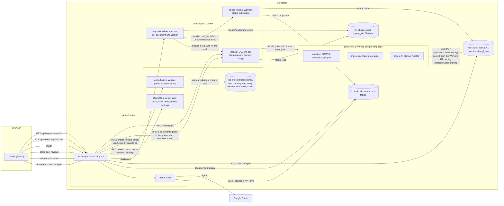
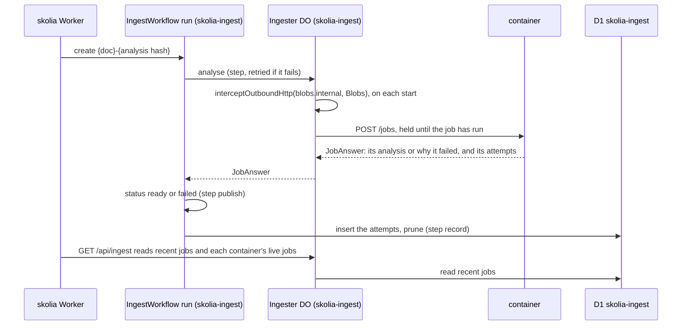
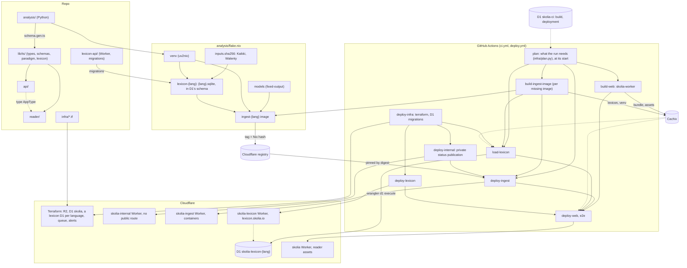

# skolia architecture

An assisted-reading app built around morphology. Tap a word or select a span. You get the lemma, the full grammatical features, the paradigm with the current form highlighted, and why the word has that form. Polish first, kept behind a language-plugin interface.

## Principles

- **Analyze once, at import.** Taps are local lookups: instant and offline. Only translations and explanations need the network.
- **UD features are the internal schema** (`Case=Gen|Number=Sing|Gender=Masc|Animacy=Anim`). Only plugins know which language they handle.
- **Track knowledge per lemma.** Known words and cards key on `(lang, lemma, upos)`, not on surface forms.
- **Keep the readings the analyzer didn't pick.** Show alternatives and let user corrections override them.
- **The LLM explains; it doesn't analyze.** It gets the sentence plus the parsed features. Its responses are cached and shared across users.
- **The source text is permanent, analysis can be thrown away, and user data points at the text** (character offsets).

## Components



The container answers each job with its result and its attempts: one, or more if storage failed and the job went back in line. The run publishes status through the API-owned `skolia-internal` Worker's `DocumentStatus` service entrypoint (which writes R2 and D1's `document_status` projection), then adds the attempts to `skolia-ingest` for the analysis page; a failure there is logged, and the document is ready all the same.



- **List documents:** one indexed D1 query returns entries and their `document_status` projections, including state, readable versions and error. Lists never read R2. New imports and ingest publications write the projection immediately; ingest has a service binding to the API, never access to its D1 database.
- Status is a discriminated union: ready requires complete artifacts, failed requires an error, and queued or failed may retain the previous artifacts. D1 stores `state` and `updated_at` as columns and puts only variant fields in `data`; R2 stores the complete status. `document_status` has no foreign key because an import publishes queued status and starts ingest before inserting the document. Analysing is live queue information, not a persisted state.
- **Open a document:** D1 has its metadata and R2’s `status.json` names its current analysis. The reader fetches the analysis by name. Browsers revalidate using the blob key as an ETag, and the API checks document visibility before returning 304.
- **Tap a word:** The reader prefetches distinct lemma IDs as paragraphs come into view, with six requests in flight. A press promotes the word in the queue. The word sheet reads the shared query cache and can look up pronunciation and recordings for inflected forms by spelling and part of speech. Setting a word’s status goes to the User DO.
- **Review:** The User DO gives the due cards and the API adds their entries from the lexicon Worker (RPC, `LexiconService.entries`). The Worker reads the same per-language D1 databases that serve the reader.
- **Import:** the API puts the text in R2, the metadata in D1 and a queued `status.json`, then starts a run of the ingest Worker's `IngestWorkflow` (`ingest/src/workflow.ts`), named for the document and the analysis version it's to make, so a run asked for twice is one run. The run asks the Ingester named after its language's image to analyse it, so a deploy that changes an image starts a new container, and the Ingester's `POST /jobs` is answered once the job has had its turn and run. A container that goes away first fails the request, and the step is tried again, up to 3 times, after 1, 2 and 4 minutes; one that doesn't answer within the hour times out the same way. While it waits, the importer's summary says where it is: the API asks the language's Ingester (a Durable Object binding to the ingest Worker), which asks a running container for its jobs (`GET /jobs`) and never starts one.
- The ingest Worker's only D1 is `skolia-ingest`, and its R2 binding serves the containers' blobs: they have no R2 credentials.
- **Analysis page:** each container reports its running and waiting jobs' stages (`GET /jobs`), and each run stores its job's attempts in `skolia-ingest`, its own D1 so the main one stays small. The API shows both, without the texts the viewer can't see.
- Lexicon lookups only see the rows of each language's version in `loaded`.

Locally, `wrangler dev` runs all three Workers and the ingest containers, with local D1, R2 and Workflows. The API reaches them through small interfaces (`api/src/ports/`, faked in the tests); ingest reaches the local bucket through the same `blobs.internal` intercept. The API writes `doc/{doc}/status.json` and its D1 projection as queued before it starts a run; the run publishes ready or failed through the API's internal RPC entrypoint from then on. Opening a document reads the blob; listing reads the projection. The container writes no status: its answer gives the analysis it made. The importer sees analysing while the container runs the job, from its `GET /jobs`.

On Cloudflare: Terraform (`infra/`) manages what wrangler doesn't: R2, D1, the queues (unused, until they're deleted) and billing alerts. All four Workers are deployed with wrangler: `skolia` with the reader as static assets on workers.dev and skolia.io (`api/wrangler.jsonc`), `skolia-ingest` with its containers, one per language (`ingest/wrangler.jsonc`), the API-owned `skolia-internal` (`api/wrangler.internal.jsonc`) with no public route, and `skolia-lexicon` (`lexicon-api/wrangler.template.jsonc`) on lexicon.skolia.io, which serves the lexicon D1s as a public API of its own; the skolia Worker binds it and passes `/api/lexicon/*` on to it, so previews, which have no lexicon hostname, read it there. Each language's lexicon build is a D1 of its own, made and loaded once by `infra/load-lexicon.py` and never written again; the lexicon Worker deploys after the load, bound to it, and before the skolia Worker. `infra/gc-lexicon.py` deletes nightly the ones no recent version of it binds. The internal Worker publishes status; it binds only the main D1 and R2, with no dependency on ingest or the public API. It deploys after schema migrations and before ingest, avoiding a circular service-binding dependency in fresh environments. Background data migrations run on the public API's cron, which deploys last: new backfills start only after their status publishers are live. Wrangler also applies their Durable Object migrations, which the Terraform provider can't do on an update (it resends the first migration and Cloudflare refuses it). A run hands each job to its language's container over HTTP and waits for the answer. The container keeps jobs in memory, sleeps when idle (the Durable Object asks ingest whether it's busy before stopping it), and has the models and lexicon in its image. It has no internet access or R2 credentials: the Durable Object intercepts its requests to `blobs.internal` and serves them from the ingest Worker's R2 binding (`Blobs` in `ingest/src/main.ts`). A job lost with its container is handed over again by its run's retry.



- D1 is bound by name. If Terraform hasn't made a database, `wrangler deploy` creates one outside Terraform, so `deploy-infra` goes first.
- The lexicon build makes each entry with `lexicon/entry.py`. Polish ingest carries Walenty for case analysis.
- `load-lexicon` only substitutes from Cachix and never fetches the inputs, so it needs the lexicon there; `build-ingest-image` pushes it only when an image is rebuilt.
- `deploy-web` waits for `deploy-lexicon`, which it binds, and for `load-lexicon` and `deploy-ingest`: the end-to-end tests read the lexicon.
- Deploys don't wait for `check`. `infra/plan.py` has a dependency graph of projects (each pnpm package by its `package.json`, `analysis/`, `infra/`, `curated/`) and the targets CI builds, checks and deploys, each node keyed by a hash of its Nix content and its build and test dependencies' keys. CI skips each one whose key `skolia-ci` has a row for: in `build` for an image, the skolia Worker's bundle or a check, done once for every environment, and as the environment's last row in `deployment` for Terraform, the ingest Worker, the lexicon, the lexicon Worker, the skolia Worker, the end-to-end tests and the curated sync. Both tables only grow.
- `schema.gen.ts` is generated from analysis; the blob keys in `lib/ts/keys.ts` are kept in step by hand.
- A preview loads each language's entries for wordfreq's 3,000 most common words only, and accepts 20 imports a day.

| Part | Tech | Responsibility |
|---|---|---|
| Client | PWA, Svelte 5 + TypeScript; one layout for phone (bottom sheet) and desktop (side panel) | Reader, word/span sheet, paradigm tables, review sessions (online for now) |
| API | Cloudflare Workers (TypeScript) | Auth, import job submission, cards and reviews, quotas; later the explain proxy and cache |
| User data | D1, a Durable Object per user | D1: users, document metadata. Durable Object: words, cards, reviews (FSRS) |
| Lexicon | D1, one per language (`skolia-lexicon-{lang}`) | Entries and form audio for the reader and flashcards |
| Blobs | R2 | Source texts and analysis blobs |
| Analysis | Python on Cloudflare Containers, fed by a Workflow run per document | Segment, analyze, write blob |
| Lexicon build | Offline Python scripts | Kaikki/Wiktionary + Morfeusz → per-language lexicon files |

## Frontend / backend split

The backend does anything heavy, anything that happens once, and anything secret. The frontend does anything that has to feel instant.

```
Import:       phone → API → queue → analysis container    (slow, once per text)
Open:         phone ← text and analysis
Tap/select:   phone ← lexicon entry via cache or Worker     (paradigm, gloss)
Translate/why: phone → API → cache or LLM                  (network, metered)
Mark/review:  phone → API → user's Durable Object         (online; offline later)
```

## Language plugin

Everything language-specific lives in `analysis/src/skolia_analysis/lang/<lang>/`. Code outside it reaches a language only through `plugin.py`, and `lang/__init__.py` lists the languages:

```python
class LanguagePlugin:
    LANG: str                                    # "pl"
    MODELS, DEFAULT_MODEL, DEFAULT_SNAP          # parsers by name, reconcile policy
    def parser(model) -> Parser
    def analyzer(parser, options, data) -> Analyzer   # text -> blob; its name versions the blob
    def lexicon_source() -> LexiconSource        # Kaikki entries in the analyser's terms
    def frames(data) -> Frames                   # its words' valency frames, for the lexicon
```

`data` is the language's data directory: whatever the plugin builds besides the lexicon (Polish: `pl-valency.json`).

Polish: COMBO (XLM-RoBERTa, trained on UD Polish PDB) picks the reading that fits the context and gives the dependency parse; Stanza models are available as alternatives. Morfeusz 2 supplies the list of candidate readings and generates the lexicon's paradigms. When the parser's reading isn't one Morfeusz allows, the closest Morfeusz reading replaces it and the parser's is kept alongside. Measured choices and scores: `analysis/EVALUATION.md`.

Why a word has its case is worked out at import (`analysis/src/skolia_analysis/lang/pl/cases.py`) from the dependency tree and the verb's valency in Walenty (IPI PAN's valency dictionary, CC BY-SA 4.0): each token with a case gets a `case_reason` (the rule, the word that causes it, and the verb or preposition). Rules: preposition, agreement, coordination, governing numeral, verb's lexical case (`szukać` + gen), negation (`nie mam czasu`), structural object, partitive, subject, predicate after `być`, possessive and noun complement, verbal noun's object, instrumental, vocative. The reader turns the reason into a sentence and underlines the triggering word.

English: Stanza (`default_accurate`, trained on UD English treebanks including EWT) gives the reading and parse on its own. There's no candidate list, case reasons or valency.

French: the same, with Stanza's French `default_accurate` (CamemBERT, trained on UD French treebanks including GSD).

## Lexicon (static, per language)

Built offline (`analysis/src/skolia_analysis/lexicon/`) into one SQLite file per language in the lexicon Worker's D1 schema (`lexicon-api/migrations`), keyed by the analyser's `lemma_id`, which `infra/load-lexicon.py` copies into D1. The lexicon follows the analyser's conventions: each Kaikki (Wiktionary) headword is looked up in Morfeusz and converted with the analyser's own code, so `który` is filed as DET just as the analyser tags it.

English and French have no Morfeusz: headwords are filed under Kaikki's part of speech mapped to UPOS, and Wiktionary's inflection table gives the paradigm.

```
entry(lemma_id, version, lemma, upos, data, lemma_lower, sense_count)  data: the Entry as JSON but its audio;
  relations, feature sets and each spelling's pronunciations and recordings in tables of their own,
  from which the Worker gives an entry its lemma's audio as it does any form's
  senses:    gloss, tags (slang, dated...), examples, and `when`: the features that select
             the sense (pies the dog: Animacy=Nhum; the cop: Animacy=Hum)
  grammar:   a `when` every sense shares (pani: Gender=Fem)
  relations: aspect-partner (robić <-> zrobić, its aspect), derived-from (pani <- pan,
             rubelek <- rubel, with how), variant-of (niechże <- niech, with Wiktionary's tags);
             the target's spelling, and its entry when the lexicon has one
  paradigms: forms with their UD feature sets by id: Wiktionary's (English, French) or
             Morfeusz's (Polish)
```

What the lexicon Worker serves is an `Entry`, made from a row in one place (`lexicon/entry.py`): its grammar adds what every form's features share (zgolić: Aspect=Perf), Wiktionary's tags for that grammar come off its senses, a word with no senses of its own takes those of the words it's derived from (zgolić, a perfective of golić, means what golić does), and it has its lemma's pronunciations, its paradigms and its frames. Each lexicon D1 stores each `Entry` whole, with the relation rows beside it for finding what points at a word (`include=incoming`). The reader renders a relation's kind in English.

Polish paradigms are Morfeusz's, generated in the analyser's feature conventions when the lexicon is built, for every entry, including the verbs only other entries name (zgolić). A verb's paradigm includes its participles and gerunds. English paradigms are stored in UD EWT's conventions: a form lists every feature set it serves (`walk` is the infinitive, the imperative and the present for every person but the third singular), since the reader matches a token to the forms whose features include the token's. French paradigms are stored in UD French GSD's conventions (an imperfect is `Tense=Imp`, a conditional `Mood=Cnd`); Wiktionary gives only the masculine singular past participle, so its feminine and plural forms follow the regular rule (`pris`, `prise`, `prises`), with the few that never agree (`été`) left alone.

The lexicon Worker serves one entry per URL, shared across documents through the browser and edge caches. Lookup falls back from the exact `lemma_id` to the lemma lowercased under the same part of speech (*Old* Town is the adjective *old*), then to the same lemma under another part of speech (English *be* as AUX is Wiktionary's verb), then to the lemma lowercased under any. The reader marks the token's form in the paradigm by its text and features, counting only features the paradigm's forms have. A full-dictionary download for search is a possible later addition (meanings only, without paradigms).

Later: showing a word's frames on its sheet ("`pomagać` + dative", from the same Walenty data the case reasons use) and `expression` (multi-word, matched by lemma sequence, from Wiktionary's phrase entries and Walenty's idioms).

## Documents and versioning

```
doc/{hash}/text.txt                                     -- permanent
doc/{hash}/status.json                                  -- import state; points at the current analysis
doc/{hash}/analysis/s{schema}-a{analyzer}.json.br       -- derived, disposable
versions/{lang}.json                                    -- what ingest produces now, written when it starts
```

- Analyses are JSON compressed with Brotli (quality 11), stored with `Content-Encoding: br` and sent as stored to clients that accept it.
- Texts are limited to 20,000 characters per import (about 3,000 words, roughly a minute of analysis), checked by the API and again by ingest. Imports aren't rate-limited yet.
- A document’s text, analysis versions and status share one prefix. `{analyzer}` is a short hash of the analyser version. Legacy bundle blobs may still exist under that prefix.
- Documents are deduped by a hash of language and text (`sha256("{lang}\n{text}")`): if many users import the same text, it's analyzed once. The text is stored once (`document`), and each user who imports it has their own entry (`user_document`) with their title, licence and visibility. A user sees their own entries and everyone's public ones; a text with no public entry is a 404 to anyone without an entry. Deleting an entry deletes only the entry: texts and their blobs are never deleted, so importing one again needn't analyse it again.
- The analysis name includes its shape (`SCHEMA`) and analyser version (plugin version, models, Morfeusz, snap policy and Walenty). Bump `PLUGIN_VERSION` when the analysis output changes and `SCHEMA` when its shape changes.
- The reader fetches the analysis by name at `/api/documents/{id}/analysis/{name}`. The URL stays stable for that version.
- Migration: The API queues an update when a ready document’s analysis name differs from `versions/{lang}.json`. The old analysis stays available until the new one is ready. Ingest reuses an analysis whose key already exists. A document queued for more than 30 minutes can restart a lost run. Storage failures are retried and analysis failures are recorded.

Token shape in the blob:

```
start, end, text, lemma, lemma_id, upos, xpos?, feats, head, deprel, candidates?
```

- `lemma_id` is a stable string key, `{lang}:{lemma}:{upos}` (e.g. `pl:pies:NOUN`). It survives lexicon rebuilds. Homographs share one `lemma_id`; the token's features pick the sense (see Lexicon). Polish participles and gerunds use their verb's id (`położony` → `pl:położyć:VERB`), because to a learner they are forms of the verb.
- `xpos` is the language-specific tag (NKJP for Polish). It's optional, and only plugins read it.
- `head` is the 0-based index of the head token in the sentence, `null` for the root. `feats` is an object.
- `candidates` is present only when there's more than one reading.

Expressions per sentence: `{ "from": 2, "to": 4, "id": "pl:dać sobie radę" }`, matched by lemma sequence. Contiguous only at first.

## User data

D1 has `document` (a user's imports and the shared library) and Better Auth's tables. Planned, not built:

```
lookup(user_id, doc_hash, char_start, char_end, at)
override(user_id, doc_hash, char_start, char_end, lemma_id, feats)
explanation_cache(key, text, model, created_at)          -- key = hash(sentence, char_start, char_end)
```

Each user's words, flashcards and reviews live in their own Durable Object (`api/src/worker/user.ts`), scheduled with ts-fsrs. The review log is the source of truth, and the cards' scheduling state is rebuilt from it. Cards hold lemma ids, and their dictionary entries come from the lexicon in D1. Details: `docs/adr/0001-flashcards.md`.

After a re-analysis, overrides are re-applied by character offset. If a token boundary has moved, the override is flagged rather than guessed.

## Span selection

Selections snap to word boundaries. Computed on the phone from the analysis:
- dependency structure within the span (head, attachments, agreement)
- government (which word is triggering which case)
- matched multi-word expressions

From the backend: a translation of the span in context, and "explain this phrase".

## Cost and tiers

- Static lexicon on a CDN: near zero.
- User data: small, D1.
- Analysis: deduped, rate-limited on the free tier, with a pre-analyzed public-domain library (Wolne Lektury for Polish). Later, on-device analysis.
- LLM: the only real per-use cost. Use a small model, a shared cache and daily quotas.

Free: reader, dictionary, paradigms, structure view, SRS, shared library, a few imports and explanations a day.
Paid (a few EUR/month): unlimited imports and explanations.

## Build order

1. Polish lexicon import from Kaikki. Check coverage on real articles.
2. Polish plugin + ingest. Check lemma, features, the "why" and ambiguity on a real paragraph.
3. Minimal reader with the word sheet.
4. Span selection + structure view.
5. Explain service.
6. Known words + SRS.
7. Auth, quotas, offline caching.

Steps 1 and 2 are the main risk. Validate them before building UI.

## Open questions

- Auth provider
- Name: skolia.com is registered (2026-07, by a domain reseller); skolia.io was free on 2026-11-04
