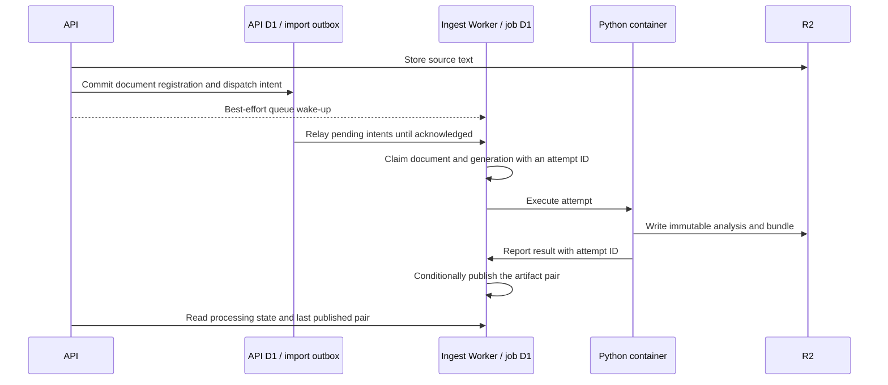

# Durable document processing

**Status** — Proposed

Document ingest currently writes a queued status to R2 and then sends a queue message. The queue acknowledges the message when a container accepts it into memory. If dispatch fails or the container disappears, opening the document after the stuck timeout can enqueue it again. The API and containers also write the same status object, and a container announces the current language versions when it starts. An older container can still write after a rollout.

Give ingest durable ownership of processing and publication. Keep the language containers as executors, the source text and artifacts in R2, and the document metadata and visibility rules in the API.

## State and ownership

- **API D1 outbox.** A new import records dispatch intent in the same transaction as document registration. The source text is already in R2 at its content-addressed key, so a failed transaction leaves a reusable source object. The relay retries unacknowledged intents. Ingest acknowledges only after its upsert commits. Replaying an intent leaves an existing claim or published reading intact.
- **Ingest D1 job.** One row per document holds its requested generation, active attempt ID, claim deadline, retry schedule, and last error. The row also holds the last published generation and its analysis and bundle keys. Index due work and expiring claims. The history tables continue to record execution events separately from authoritative job state.
- **Deployment generation.** Deploy supplies the desired generation per language. It identifies the executor image and expected analysis and bundle versions. A restarted container uses the generation it was asked to execute. A rollback selects the old release inputs through a new generation so delayed requests cannot undo the newer deployment decision.
- **API reads.** Ingest exposes a batch status RPC for document summaries. The API determines which documents the viewer can see before requesting status and continues to authorize artifact reads. The reader loads the published analysis and bundle by their existing versioned URLs.

## Claiming, recovery, and publication

A queue wake-up or scheduled sweep finds due work. Ingest claims it with one conditional update that assigns a unique attempt ID and deadline. A duplicate wake-up finds the live claim. The queue can acknowledge once the durable state is recorded. Scheduled recovery uses bounded batches and retry backoff. A running attempt can renew its deadline, and only the current attempt can renew it.

The container accepts a document, generation, and attempt ID. It does the same language processing as today and reports success or failure to ingest. On success, ingest verifies the expected artifact keys are present and then makes a conditional update matching the requested generation and active attempt. That update publishes both keys together. A duplicate completion is harmless, and a late completion leaves a newer attempt or publication intact.

Retries may repeat computation. Reuse complete versioned artifacts where possible and enforce immutable writes so overlapping attempts cannot change bytes under an existing URL. Transient dispatch, storage, and container failures retry with backoff. Deterministic analysis failures end the attempt. A failed update leaves the last successful pair readable.

## Rollout

1. Persist import intent and ingest claims. Keep the existing reading contract and status publication during this step. Exercise a failed queue send and a container loss after acceptance, and verify both recover without a document GET. Scope automatic recovery to work registered in the new workflow.
2. Move publication behind the conditional generation and attempt update. Seed the published pair from valid legacy status where needed and retain a read fallback during migration. Switch new writers and readers in deploy order. Exercise overlapping generations, duplicate completion, and a crash between artifact upload and publication. Preserve the old pair throughout an update or a failed retry.
3. Remove read-triggered recovery and legacy status writes once legacy jobs have drained or been reconciled. Use the same scheduler to refresh the curated library at a controlled rate.

## Tradeoff

The design adds a relay, a scheduled sweep, and an RPC read for job state. It also removes the per-document status object reads from the steady-state list path after migration. Durable leases and conditional publication make recovery observable and constrain what duplicate execution can affect. A managed workflow engine is a possible implementation of the retry loop. The import handoff and conditional publication would still need the same guarantees.
